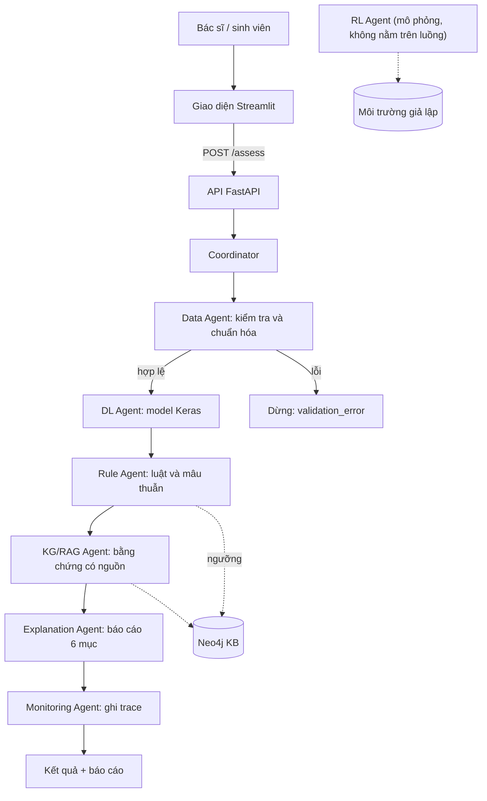

# Hệ đa agent lai hỗ trợ quyết định bệnh tiểu đường

**Môn:** Phát triển các hệ thống thông minh – PTIT
**Loại:** Project cuối môn (prototype học tập và nghiên cứu)

> Hệ thống là prototype học tập. Kết quả **không phải chẩn đoán xác định** và chưa được kiểm chứng lâm sàng.

---

## Tóm tắt

Hệ thống kết hợp học sâu (DL), đồ thị tri thức Neo4j với truy xuất bằng chứng (KG/RAG), luật tường minh và một agent điều phối (Coordinator) để hỗ trợ quyết định về nguy cơ tiểu đường. Mô hình DL đạt ROC-AUC 0,975 và recall 0,712 trên tập test gồm 14.422 ca. Lớp luật bắt thêm được 126 trong 367 ca dương tính mà model bỏ sót, nhưng đồng thời làm tăng 3.088 báo động trên ca không có bệnh, nên precision giảm từ 0,933 xuống 0,246. Vì vậy báo cáo đề xuất dùng lớp luật như **cờ cần chuyên gia xem xét** chứ không dùng làm quyết định thay thế model. Mọi cờ và bằng chứng đều có nguồn truy vết được. Hệ thống có 157 test tự động, API FastAPI và giao diện Streamlit.

---

## 1. Giới thiệu và mục tiêu

Bệnh tiểu đường có thể được phát hiện sớm nếu kết hợp nhiều nguồn thông tin: đặc điểm nhân trắc và lối sống, kết quả xét nghiệm, và tri thức y khoa về ngưỡng chẩn đoán. Đề tài xây dựng một hệ đa agent để:

1. Dự đoán nguy cơ tiểu đường từ dữ liệu bệnh nhân bằng mô hình học sâu đã huấn luyện.
2. Kiểm tra kết quả bằng luật tường minh và ngưỡng chẩn đoán lấy từ đồ thị tri thức.
3. Truy xuất bằng chứng có nguồn để giải thích kết quả.
4. Tạo báo cáo hỗ trợ quyết định, ghi rõ giới hạn và các trường hợp cần chuyên gia xem xét.
5. Ghi nhật ký vận hành và đánh giá hệ thống theo các chỉ số định lượng.

Phạm vi không bao gồm chẩn đoán lâm sàng, kê đơn, hay phân biệt tiểu đường loại 1 và loại 2 (dataset không có nhãn này).

## 2. Kiến trúc hệ thống

### 2.1 Kiến trúc sáu lớp

| Lớp | Thành phần | Vai trò |
|---|---|---|
| 1. Giao diện người dùng | `ui/streamlit_app.py` | Nhập thông tin, hiển thị báo cáo, trace, cờ mâu thuẫn |
| 2. API và xử lý dữ liệu | `app/api.py`, `app/service.py` | Nhận request, ánh xạ trạng thái sang mã HTTP |
| 3. Điều phối | `app/coordinator.py` | Chạy các agent theo 12 bước, gom kết quả, xử lý lỗi từng phần |
| 4. Agent thông minh | Data, DL, Rule, KG/RAG, Explanation, Monitoring | Mỗi agent một nhiệm vụ, trả `AgentMessage` |
| 5. Tri thức và mô hình | Model Keras, Neo4j (KB), môi trường mô phỏng | Nguồn dự đoán và tri thức |
| 6. Đánh giá và kiểm toán | `logs/audit.jsonl`, `reports/` | Trace từng request, thống kê, báo cáo đánh giá |

### 2.2 Sơ đồ luồng xử lý



### 2.3 Nguyên tắc thiết kế

- **Trách nhiệm đơn:** mỗi agent làm một việc, có thể kiểm thử riêng.
- **Giao diện rõ ràng:** mọi agent trả `AgentMessage` gồm `status`, `payload`, `evidence`, `version`.
- **Không giấu lỗi:** agent trả `status = "error"` thay vì ném exception. Coordinator tiếp tục các phần còn lại và ghi trạng thái `partial`.
- **Giữ tách biệt:** dự đoán model, cờ luật và bằng chứng được trả về riêng biệt, không trộn thành một con số.
- **Truy vết:** mỗi cờ luật và mỗi bằng chứng đều gắn `source_id` trỏ tới nguồn có URL.

## 3. Mô tả các agent

| Agent | Mô hình AI | Đầu vào | Đầu ra chính | Kiểm thử |
|---|---|---|---|---|
| Patient Data | Xử lý xác định | dict thô | Feature đã chuẩn hóa, danh sách lỗi | 13 test |
| DL Prediction | Học sâu (Keras) | Feature hợp lệ | Nhãn, xác suất, ngưỡng, phiên bản model | 6 test đơn vị, 1 test model thật |
| Rule-Based | Suy luận ký hiệu | Feature, dự đoán | Cờ có mã và mức, cờ mâu thuẫn | 18 test, 1 test KB thật |
| KG/RAG | Đồ thị tri thức, truy xuất | Câu hỏi | Bằng chứng có nguồn | 13 test, 2 test Neo4j thật |
| Explanation | Template | Kết quả các agent | Báo cáo 6 mục | 17 test, 4 test tích hợp |
| Monitoring | Ghi nhật ký, thống kê | Trace | `audit.jsonl`, thống kê | 14 test, 1 test tích hợp |
| Coordinator | Điều phối | Yêu cầu | Kết quả có cấu trúc | 17 test, 5 test tích hợp, 1 test thật |
| RL (tùy chọn) | Q-learning trong mô phỏng | Mức nguy cơ giả lập | Hành động mô phỏng | 11 test |

### 3.1 Patient Data Agent

Kiểm tra đủ tám đặc trưng, số hữu hạn (không nhận NaN và vô cực), khoảng giá trị hợp lý, nhãn nhị phân chỉ 0 hoặc 1, và danh mục categorical không phân biệt hoa thường. Số viết bằng dấu phẩy được chấp nhận. Trường lạ bị bỏ qua và được liệt kê.

### 3.2 DL Prediction Agent

Model là mạng nơ-ron dày với hai lớp ẩn 64 và 32 nơ-ron, có Dropout, EarlyStopping theo AUC validation và trọng số lớp để bù mất cân bằng (tỉ lệ dương tính 8,8%). Tiền xử lý gồm chuẩn hóa số, giữ nguyên nhị phân và mã hóa one-hot cho categorical. Ngưỡng quyết định 0,85 được chọn trên tập validation để tối ưu F1, không dùng tập test.

### 3.3 Rule-Based Agent

Ngưỡng xét nghiệm được **đọc từ Neo4j**, không hard-code:

| Xét nghiệm | Ngưỡng chẩn đoán | Khoảng tiền tiểu đường |
|---|---|---|
| HbA1c | ≥ 6,5% | 5,7–6,4% |
| Đường huyết lúc đói | ≥ 126 mg/dL | 100–125 mg/dL |
| Đường huyết ngẫu nhiên / OGTT | ≥ 200 mg/dL | 140–199 mg/dL (OGTT) |

Các luật gồm: R01 và R02 cho HbA1c, R03 đến R05 cho đường huyết, R06 đến R10 cho yếu tố nguy cơ (tuổi, BMI, tăng huyết áp, bệnh tim, hút thuốc). Hai luật mâu thuẫn C01 và C02 so sánh model với xét nghiệm và đánh dấu cần chuyên gia xem xét. Tuổi 45 và BMI 30 không có trong KG nên được khai báo trực tiếp và ghi chú rõ.

### 3.4 KG/RAG Agent

Đồ thị tri thức có 52 thực thể (bệnh, triệu chứng, yếu tố nguy cơ, biến chứng, xét nghiệm, lời khuyên, cột dữ liệu), 67 quan hệ và 19 nguồn. Nguồn gồm WHO, ADA (các phiên bản 2021, 2023, 2026), Vinmec, Long Châu, Pharmacity, VnExpress và Bệnh viện Tâm Anh. Nội dung được diễn đạt lại, không sao chép nguyên văn. Agent nhận diện thực thể bằng khớp cụm không dấu, ưu tiên cụm dài nhất, rồi lấy láng giềng trong đồ thị.

### 3.5 Explanation Agent

Báo cáo gồm sáu mục: dự đoán của mô hình, cờ luật (sắp theo mức), mâu thuẫn cần xem xét, bằng chứng đánh số kèm nguồn, gợi ý và giới hạn. Báo cáo luôn ghi rõ không phải chẩn đoán xác định. Không có khuyến nghị thuốc hay liều dùng, và có kiểm thử cho điều này. Khi một agent lỗi, báo cáo vẫn được tạo và ghi rõ phần thiếu.

### 3.6 Coordinator

Coordinator chạy theo 12 bước của tài liệu kiến trúc. Nếu dữ liệu sai thì dừng ngay và không gọi model. Nếu DL lỗi thì Rule vẫn chạy với dự đoán rỗng. Nếu KG hoặc Rule lỗi thì các phần còn lại vẫn được trả về với trạng thái `partial`. Mọi exception đều được bắt và ghi trace.

### 3.7 Monitoring Agent

Mỗi request ghi một dòng JSON vào `logs/audit.jsonl` gồm thời gian, mã request, kết quả, thời gian từng bước, agent lỗi và phiên bản. **Log không chứa giá trị đặc trưng của bệnh nhân**, và có kiểm thử xác nhận điều này bằng cách chạy coordinator thật rồi tìm các giá trị nhạy cảm trong file.

## 4. Tích hợp mô hình và tri thức

### 4.1 Dữ liệu và mô hình

- **Dataset:** 100.000 dòng, 8 đặc trưng và nhãn nhị phân `diabetes`. Sau khi loại 3.854 dòng trùng còn 96.146 dòng, tỉ lệ dương tính 8,82%.
- **Chia tập:** train 67.302, validation 14.422, test 14.422 (phân tầng theo nhãn, seed 42).
- **Huấn luyện lại:** sau khi mất thư mục model, huấn luyện lại cho đúng các chỉ số cũ, cho thấy quy trình tái lập được.

### 4.2 Kết quả trên tập test

| Metric | Giá trị |
|---|---|
| Accuracy | 0,970 |
| Precision | 0,933 |
| Recall | 0,7115 |
| F1 | 0,807 |
| ROC-AUC | 0,9749 |

Ma trận nhầm lẫn: TN 13.085, FP 65, FN 367, TP 905. Số tính lại từ tập test khớp với model card (chênh lệch trong sai số làm tròn). Recall 0,71 nghĩa là model bỏ sót khoảng 29% ca có bệnh, nên đây là lý do chính để bổ sung lớp luật.

### 4.3 Tri thức có nguồn

Toàn bộ 82 bằng chứng trả về trên 10 câu hỏi chuẩn đều có nguồn (100%). Chỉ số này đo việc **có gắn nguồn**, không đo tính đúng đắn y khoa của nội dung. Việc thẩm định nội dung cần chuyên gia.

## 5. Kết quả đánh giá

### 5.1 Ablation: DL một mình và DL cộng Rule

| Cấu hình | TP | FP | FN | Precision | Recall | F1 |
|---|---|---|---|---|---|---|
| DL một mình | 905 | 65 | 367 | 0,933 | 0,7115 | 0,807 |
| DL + Rule (cảnh báo khi R01 hoặc R03) | 1.031 | 3.153 | 241 | 0,246 | 0,8105 | 0,378 |

Cấu hình "DL + Rule" trong bảng quyết định dương khi model dự đoán dương **hoặc** luật có cờ R01 (HbA1c ≥ 6,5%) hoặc R03 (đường huyết ≥ 200 mg/dL).

**Diễn giải:**

- Lớp luật bắt được **126 trong 367** ca bị DL bỏ sót (khoảng 34%), nên recall tăng 9,9 điểm phần trăm.
- Đổi lại, lớp luật tạo thêm **3.088 báo động** trên các ca không có bệnh. Trong 13.150 ca không có bệnh, tỉ lệ báo động tăng từ 0,5% lên 24%.
- Nguyên nhân là ngưỡng xét nghiệm theo ADA không khớp hoàn toàn với nhãn trong dataset. Có nhiều ca có HbA1c hoặc đường huyết vượt ngưỡng nhưng nhãn ghi không bệnh. Dataset không ghi thời điểm đo đường huyết nên không thể lọc ca nhịn ăn.

**Kết luận và đề xuất:** trên dataset này, dùng luật như một quyết định ghi đè làm precision giảm quá mạnh, không chấp nhận được cho sàng lọc. Lớp luật nên đóng vai trò **cờ cần xem xét**, giữ DL làm quyết định chính. Báo cáo không trình bày cấu hình DL + Rule như một cải thiện đơn thuần.

### 5.2 Cờ cần chuyên gia xem xét

Trong tập test có **3.214 ca (22,3%)** được đánh dấu cần chuyên gia xem xét vì mâu thuẫn giữa model và xét nghiệm. Con số này quá lớn để dùng cho sàng lọc thực tế, và cần được nêu trong hạn chế.

### 5.3 Ca thử có nhãn

Năm ca mỗi nhóm được chọn ngẫu nhiên với seed cố định (chỉ số trong tập test):

- **TP (đúng, model phát hiện được):** 10555, 1977, 425, 12234, 4579. Điểm DL từ 0,997 đến 1,0. Cả năm ca đều có cờ luật.
- **FN (bỏ sót):** 4743, 4547, 2791, 2072, 13522. Điểm DL từ 0,29 đến 0,65. Ba ca có cờ luật. Đây là nhóm lớp luật có giá trị nhất.
- **FP (báo động nhầm):** 2130, 12338, 632, 621, 5458. Điểm DL từ 0,85 đến 0,90. Bốn ca có cờ luật, cho thấy nguồn gốc của báo động thêm.
- **TN (đúng, không bệnh):** 4205, 9120, 10863, 478, 10142. Điểm DL từ 0,0 đến 0,20.

Bảng ca thử đầy đủ nằm trong `reports/evaluation.md`.

### 5.4 Độ trễ và nhất quán

Đo trên 30 request qua toàn bộ Coordinator:

| Chỉ số | Giá trị |
|---|---|
| Tổng trung bình | 186,7 ms |
| p50 | 154 ms |
| p95 | 240 ms |
| Trung bình DL | 48,9 ms |
| Trung bình KG/RAG | 137,9 ms |

KG chiếm khoảng 74% thời gian, do truy vấn tới Neo4j Aura qua mạng. Các agent chạy trong bộ nhớ (Data, Rule, Explanation) có thời gian dưới 1 ms nên hiển thị là 0 vì đơn vị đo là mili-giây nguyên. Số đo chỉ mang tính tương đối vì phụ thuộc đường truyền và máy chạy thử. Cỡ mẫu 30 là nhỏ.

**Nhất quán:** 30/30 ca cho cùng dự đoán khi đi qua toàn bộ Coordinator và khi chạy batch trực tiếp. Tất cả 30 request trả trạng thái `ok`.

## 6. Thảo luận

### 6.1 Điểm mạnh

- Mô hình DL đạt chất lượng cao trên dữ liệu công khai (ROC-AUC 0,975).
- Mọi kết luận đều truy được về nguồn: cờ luật có nguồn, bằng chứng có URL, ngưỡng đọc từ KG có nguồn.
- Hệ thống xử lý lỗi từng phần, không sập khi một agent hỏng, và đánh dấu rõ kết quả thiếu.
- Log không chứa dữ liệu bệnh nhân, và có kiểm thử cho điều này.
- Tái lập được: cùng seed cho cùng tập test và cùng chỉ số khi huấn luyện lại.

### 6.2 Hạn chế

1. **Dataset:** dữ liệu công khai, không rõ quy trình thu thập, không phân biệt loại 1 và loại 2, không ghi thời điểm đo đường huyết.
2. **Mâu thuẫn giữa luật và nhãn dataset:** ngưỡng ADA cho báo động nhiều ca mà nhãn dataset ghi là không bệnh (xem 5.1).
3. **Số cờ cần xem xét quá lớn:** 22% tập test, không phù hợp cho sàng lọc thực tế nếu không hiệu chỉnh.
4. **Ngưỡng chưa đầy đủ trong KG:** tuổi 45 và BMI 30 chưa có trong đồ thị tri thức.
5. **Tri thức chưa được chuyên gia thẩm định:** tính đúng của nội dung KB chưa được kiểm chứng y khoa.
6. **Model không được hiệu chỉnh xác suất:** điểm số DL không phải xác suất thật, nên ngưỡng 0,85 chỉ là ngưỡng quyết định kỹ thuật.
7. **Độ trễ đo trên mẫu nhỏ** và phụ thuộc hạ tầng.

### 6.3 Về lớp Reinforcement Learning

Môi trường mô phỏng có nội dung giáo dục và khoảng tái khám. Q-learning học được chính sách: nguy cơ thấp tái khám sau 6 tháng, nguy cơ trung bình và cao có nội dung dinh dưỡng với khoảng 3 và 1 tháng. Chính sách này cho lợi ích -7,70, tốt hơn ngẫu nhiên (-8,94) và tốt hơn nhiều so với cố định 6 tháng không nội dung (-14,15). Tuy nhiên, chính sách học được **bằng với quy tắc đơn giản** (-7,70). Lý do là trong mô phỏng, nội dung lối sống và dinh dưỡng có tác động giống hệt nhau, nên thuật toán không có gì để phân biệt. Đây là giới hạn của mô phỏng, không phải phát hiện về bệnh nhân thật. Các xác suất chuyển trạng thái là giả định, không phải số liệu lâm sàng, và RL không nằm trên luồng chẩn đoán.

## 7. An toàn và đạo đức

- Hệ thống là prototype học tập. Mỗi báo cáo đều ghi rõ không phải chẩn đoán xác định.
- Không có luật nào đưa ra thuốc hay liều dùng. Có kiểm thử cho điều này trong cả luật và báo cáo.
- RL chỉ chạy trong mô phỏng và mọi đầu ra của nó được đánh dấu `simulated`.
- Log không lưu giá trị đặc trưng bệnh nhân.
- Dataset là dữ liệu công khai, không chứa thông tin định danh.
- Kết quả mâu thuẫn hoặc không chắc chắn được chuyển cho chuyên gia xem xét, không tự động kết luận.

## 8. Kiểm thử

| Nhóm | Số test | Ghi chú |
|---|---|---|
| Đơn vị các agent | 96 | Không cần TensorFlow hay Neo4j |
| Tích hợp Coordinator, Explanation, Monitoring | 15 | Dùng agent giả cho DL |
| API và lớp service | 10 | API tự bỏ qua nếu chưa cài fastapi |
| Đánh giá và mô phỏng | 24 | Hàm thuần, kiểm tra tái lập |
| Kiểm thử với model và Neo4j thật | 7 | Tự bỏ qua nếu thiếu tài nguyên |
| **Tổng** | **157** | Tất cả đều đạt trên máy thực nghiệm |

## 9. Kết luận và hướng phát triển

Đề tài xây dựng thành công một hệ đa agent hoàn chỉnh theo kiến trúc đã đề ra: từ kiểm tra dữ liệu, dự đoán bằng học sâu, kiểm tra bằng luật lấy ngưỡng từ đồ thị tri thức có nguồn, đến báo cáo giải thích có giới hạn rõ ràng. Mô hình DL đạt ROC-AUC 0,975. Đánh giá cho thấy lớp luật có giá trị ở vai trò cảnh báo và truy vết, nhưng không nên dùng để ghi đè quyết định của mô hình trên dataset này.

**Hướng phát triển:**
1. Hiệu chỉnh ngưỡng luật bằng dữ liệu đo lúc đói, hoặc bổ sung trường thời điểm đo vào dataset.
2. Đưa ngưỡng tuổi và BMI vào KG để thống nhất mọi ngưỡng.
3. Hiệu chỉnh xác suất của model (ví dụ Platt scaling hoặc isotonic regression) để điểm số có ý nghĩa xác suất.
4. Thẩm định nội dung KB với chuyên gia y tế.
5. Trong mô phỏng RL, phân biệt tác động của các loại nội dung để chính sách học được có ý nghĩa.
6. Thêm LLM cho phần giải thích (Explanation Agent) với ràng buộc chỉ dùng thông tin trong kết quả các agent.

---

## Phụ lục A. Cách chạy hệ thống

```bash
# Cài đặt
python -m venv .venv && source .venv/bin/activate
pip install -r requirements.txt
cp .env.example .env          # điền thông tin Neo4j

# Dữ liệu và model
python scripts/train_model.py
python scripts/load_kb.py

# Kiểm thử
pytest -v

# Chạy hệ thống
uvicorn app.api:app --reload          # API: http://localhost:8000/docs
streamlit run ui/streamlit_app.py     # giao diện: http://localhost:8501

# Đánh giá và mô phỏng
python scripts/evaluate_system.py
python scripts/run_simulation.py
python scripts/audit_summary.py
```

## Phụ lục B. Cấu trúc thư mục chính

```
diabetes-mas/
├── app/         config, schemas, features, coordinator, api, service, evaluation, sources
│   └── agents/  data, dl, rule, kg_rag, explanation, monitoring, rl
├── kb/          DB_diabet.cypher (sinh từ scripts/build_kb.py)
├── models/      model.keras, preprocessor.joblib, model_meta.json, model_card.md
├── data/        diabetes_prediction_dataset.csv
├── sim/         môi trường mô phỏng và Q-learning
├── scripts/     huấn luyện, nạp KB, thử nghiệm, đánh giá, mô phỏng
├── tests/       157 test
├── ui/          streamlit_app.py
├── reports/     evaluation.md, evaluation.json, rl_simulation.md, rl_policy.json
└── logs/        audit.jsonl
```

## Phụ lục C. Nguồn tri thức chính

WHO (fact sheet tiểu đường); ADA Standards of Care 2026, mục 2 (chẩn đoán và phân loại); ADA 2021 (tiêu chí sàng lọc tiền tiểu đường); Vinmec (triệu chứng sớm và chủ đề đái tháo đường type 2); Nhà thuốc Long Châu, Pharmacity, VnExpress, Bệnh viện Tâm Anh (triệu chứng, biến chứng, yếu tố nguy cơ). Danh sách đầy đủ 19 nguồn kèm URL nằm trong `scripts/build_kb.py` và `app/sources.py`.
