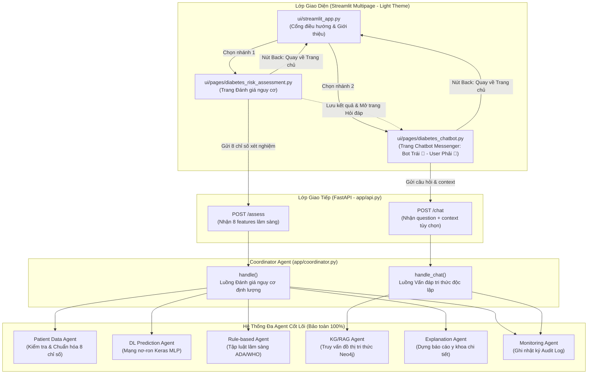

# BÁO CÁO TÁI CẤU TRÚC HỆ THỐNG TOÀN DIỆN (REFACTORING DOCUMENTATION)

**Dự án:** Diabetes Multi-Agent System (Hệ Đa Agent Hỗ Trợ Quyết Định & Vấn Đáp Tiểu Đường)  
**Môn học:** Phát triển các hệ thống thông minh – Học viện Công nghệ Bưu chính Viễn thông (PTIT)  
**Thời gian hoàn thành:** 13/11/2026  
**Mục tiêu tài liệu:** Cung cấp tài liệu hoàn chỉnh, độc lập và chi tiết từ A đến Z về quá trình tái cấu trúc hệ thống: từ phân tách trang nghiệp vụ, cơ chế độc lập ngữ cảnh, luồng xử lý backend, thiết kế cửa sổ hội thoại hai chiều phong cách Messenger chuẩn mực (Bot bên trái kèm icon Robot 🤖, Người dùng bên phải với bong bóng ôm sát chữ và icon Person 👤 ở lề ngoài cùng bên phải), đến bộ kiểm thử tự động toàn diện (bao gồm kiểm thử giao diện với Streamlit AppTest).

---

## 1. Bối cảnh & Động lực tái cấu trúc (Motivation & Problem Statement)

### 1.1. Hiện trạng ban đầu của hệ thống
Trước đợt tái cấu trúc, toàn bộ giao diện tương tác của dự án được đặt trong một file duy nhất: `ui/streamlit_app.py`.
* **Giao diện nguyên khối (Monolithic UI):** Một trang duy nhất chứa đồng thời:
  * Form nhập 8 chỉ số xét nghiệm định lượng (Tuổi, Giới tính, BMI, HbA1c, Đường huyết lúc đói, Tăng huyết áp, Bệnh tim, Tiền sử hút thuốc lá).
  * Một ô nhập văn bản tự do: `question = st.text_input("Câu hỏi thêm (tùy chọn)")`.
* **Luồng xử lý gộp chung (Coupled Pipeline):** Khi người dùng bấm nút "Phân tích", backend gọi duy nhất một endpoint `POST /assess` qua phương thức `CoordinatorAgent.handle(features, question)`. Luồng này kích hoạt toàn bộ 5 Agent trong hệ thống:
  $$\text{Data Agent} \longrightarrow \text{DL Agent (Keras)} \longrightarrow \text{Rule Agent} \longrightarrow \text{KG Agent (Neo4j)} \longrightarrow \text{Explanation Agent}$$

### 1.2. Những bất cập nảy sinh trong thực tế
1. **Trải nghiệm người dùng bị phân mảnh:** Người dùng chỉ có nhu cầu tra cứu kiến thức y khoa đại chúng (ví dụ: *"Tiểu đường tuýp 2 nên ăn gì?", "Triệu chứng hạ đường huyết là gì?"*) vẫn bắt buộc phải đối mặt với một bảng nhập 8 chỉ số xét nghiệm phức tạp.
2. **Nguy cơ nhiễm dữ liệu mặc định (Context Pollution):** Trên form đánh giá, các ô nhập liệu luôn chứa sẵn các giá trị số khởi tạo giao diện (UI defaults) như `Tuổi: 45`, `BMI: 25.0`, `HbA1c: 5.5%`, `Đường huyết: 100 mg/dL`. Nếu một người chỉ vào web để trò chuyện, việc gộp chung dễ dẫn đến việc hệ thống ngầm hiểu người hỏi mang các thông số mặc định này, gây sai lệch nghiêm trọng về mặt tư vấn y khoa.
3. **Lãng phí tài nguyên tính toán:** Khi người dùng chỉ hỏi một câu lý thuyết, việc chạy tiền xử lý dữ liệu và suy luận qua mạng nơ-ron Deep Learning là hoàn toàn dư thừa, làm tăng độ trễ phản hồi không cần thiết.
4. **Vấn đề hiển thị tin nhắn người dùng chưa chuẩn giao diện chat:**
   * Trước đây, khi hiển thị câu hỏi của người dùng, icon Person `👤` lại nằm ở bên trái văn bản câu hỏi, và bong bóng tin nhắn bị kéo giãn chiếm toàn bộ 100% chiều rộng của cột, trông giống một thanh thông báo toàn màn hình hơn là một bong bóng trò chuyện.
   * Trong các ứng dụng nhắn tin chuẩn mực (Messenger, Zalo, Telegram, iMessage), câu hỏi của người dùng phải **nằm gọn gàng bên phải**, **bong bóng chỉ ôm sát độ dài của chữ**, và **icon Person `👤` phải nằm ở ngoài cùng bên phải lề**.
5. **Giao diện chưa tối ưu:** Thiếu sự đồng bộ về tông màu sáng chuẩn y tế, lạm dụng biểu tượng cảm xúc (emoji/icon) gây rối mắt, và thiếu các nút điều hướng quay về trang chủ tiện lợi.

---

## 2. Ý tưởng thiết kế & Triết lý kiến trúc mới (Architecture & Design Philosophy)

Hệ thống được thiết kế lại dựa trên 5 nguyên tắc nền tảng:

### Nguyên tắc 1: Phân tách trách nhiệm triệt để (Separation of Concerns)
* Tách biệt rõ ràng 2 nghiệp vụ thành **2 trang con độc lập** và **2 luồng API chuyên biệt**:
  * **Trang 1 – Đánh giá nguy cơ (`ui/pages/diabetes_risk_assessment.py`):** Chuyên trách sàng lọc định lượng dựa trên 8 chỉ số xét nghiệm. Bỏ hoàn toàn ô nhập câu hỏi text.
  * **Trang 2 – Hỏi đáp y tế (`ui/pages/diabetes_chatbot.py`):** Chuyên trách vấn đáp tri thức y khoa từ Knowledge Graph dưới dạng **cửa sổ trò chuyện Messenger hai chiều**.

### Nguyên tắc 2: Cơ chế Ngữ cảnh độc lập (Decoupled by Default)
* **Vào thẳng Chatbot:** Ngữ cảnh bệnh nhân được gán giá trị mặc định là `None`. Hệ thống hoạt động ở chế độ *Hỏi đáp kiến thức y tế đại chúng*, trả lời thuần túy lý thuyết y khoa (ADA, WHO, Vinmec), tuyệt đối không suy đoán hay áp đặt bất kỳ chỉ số mặc định nào.
* **Chuyển ngữ cảnh có kiểm soát:** Chỉ khi người dùng thực hiện đánh giá ở Trang 1 và **chủ động bấm nút** *"Lưu kết quả và Chuyển sang Hỏi đáp y tế"*, các thông số xét nghiệm mới được lưu tạm vào `st.session_state["patient_context"]`.
* **Quyền chủ động của người dùng:** Tại trang Chatbot, luôn có nút **`[Ngắt liên kết hồ sơ]`** để người dùng xóa ngữ cảnh bất kỳ lúc nào và trở về chế độ hỏi đáp phổ quát.

### Nguyên tắc 3: Bố cục Cửa sổ trò chuyện Messenger hai chiều Chuẩn mực
* **Trợ lý (Bot) ở BÊN TRÁI kèm Icon Robot 🤖:**
  * Bố trí qua layout cột `st.columns([5, 1])` bên trái màn hình.
  * Sử dụng component gốc: `with st.chat_message("assistant", avatar="🤖")`.
  * Bong bóng tin nhắn bo góc chuẩn tin nhắn đến (`4px 16px 16px 16px`), nền xám nhạt (`#f8fafc`), viền xám trang nhã (`#e2e8f0`).
  * Phía dưới là hộp mở rộng xem trích dẫn nguồn y khoa uy tín từ Knowledge Graph.
* **Người dùng (User) ở BÊN PHẢI kèm Icon Person 👤 ở ngoài cùng lề phải:**
  * Bố trí linh hoạt qua Flexbox `justify-content: flex-end; align-items: flex-end; gap: 10px;`.
  * **Bong bóng tin nhắn ôm sát chữ (Wrap content):** Nền xanh y tế (`#0284c7`), chữ trắng tinh khiết (`#ffffff`), `max-width: 72%`, tự động co giãn theo độ dài câu hỏi thực tế, bo góc chuẩn tin nhắn đi (`18px 18px 4px 18px`).
  * **Icon Person 👤 nằm ở lề ngoài cùng bên phải:** Hình tròn đường kính 36px nền xanh y tế, nằm ngay sát cạnh bong bóng tin nhắn của người dùng như giao diện Messenger thực thụ.
* **Lược bỏ các gợi ý thừa:** Không đưa các khối nút gợi ý chủ đề rườm rà vào cửa sổ chat để giữ không gian đàm thoại thanh lịch, tập trung hoàn toàn vào khung nhập liệu dạng Messenger ở đáy màn hình.

### Nguyên tắc 4: Tinh giản biểu tượng & Giao diện sáng (Light Theme & Minimalist UI)
* Áp dụng bảng màu sáng chuẩn y tế: Nền trắng tinh khiết (`#ffffff`), khối phụ xám nhạt (`#f8fafc`), chữ xám đen độ tương phản cao (`#0f172a`), điểm nhấn màu xanh y tế (`#0284c7`).
* Hạn chế tối đa icon rườm rà: Thay thế các biểu tượng cảm xúc sặc sỡ bằng typography sắc nét và các thẻ nhãn chữ thanh lịch (`[Mức cao]`, `[Mức trung bình]`, `[Mức thấp]`, `[Cần xem xét]`).
* Cung cấp nút bấm **`← Quay về Trang chủ`** ở đầu mỗi trang con để người dùng đổi trang linh hoạt.

### Nguyên tắc 5: Bảo vệ tuyệt đối các thành phần cốt lõi (Zero Core Regression)
* Toàn bộ tập dữ liệu (`data/`), các file mô hình nơ-ron đã huấn luyện (`models/model.keras`, `models/preprocessor.joblib`), đồ thị tri thức Neo4j (`kb/DB_diabet.cypher`) được giữ nguyên 100%.
* Bảo toàn và mở rộng hệ thống kiểm thử tự động (Unit Tests & UI AppTests), đảm bảo 162 bài kiểm thử vượt qua 100%.

---

## 3. Sơ đồ Kiến trúc & Luồng dữ liệu mới



---

## 4. Chi tiết Thay đổi theo từng File (File-by-File Breakdown)

### 4.1. Cấu hình Giao diện Sáng (`.streamlit/config.toml`)
* **Loại thay đổi:** Tạo mới file cấu hình hệ thống Streamlit.
* **Mục đích:** Thiết lập chủ đề giao diện sáng (Light Theme) mặc định trên toàn ứng dụng.
* **Nội dung cấu hình:**
  ```toml
  [theme]
  base = "light"
  primaryColor = "#0284c7"           # Màu xanh y tế chủ đạo (Sky blue)
  backgroundColor = "#ffffff"        # Nền trắng tinh khiết
  secondaryBackgroundColor = "#f8fafc" # Nền xám nhạt cho sidebar và thẻ
  textColor = "#0f172a"              # Màu chữ slate sẫm, độ tương phản cao
  font = "sans serif"

  [server]
  headless = true
  enableCORS = false
  enableXsrfProtection = true
  ```

---

### 4.2. Mở rộng Schemas Dữ liệu (`app/schemas.py`)
* **Loại thay đổi:** Bổ sung schemas Pydantic mới, giữ nguyên `PatientRequest`.
* **Mục đích:** Chuẩn hóa dữ liệu gửi lên và trả về cho riêng luồng hỏi đáp hội thoại.
* **Chi tiết mã nguồn:**
  ```python
  class ChatRequest(BaseModel):
      question: str
      context: Optional[dict[str, Any]] = None   # Chỉ số bệnh nhân (nếu liên kết từ trang đánh giá)
      history: Optional[list[dict[str, str]]] = None

  class ChatResponse(BaseModel):
      request_id: str
      status: str = "ok"                          # "ok" | "partial" | "error"
      answer: str                                 # Câu trả lời hội thoại có cấu trúc
      evidence: list[dict[str, Any]] = Field(default_factory=list)
      has_patient_context: bool = False
      errors: list[dict[str, Any]] = Field(default_factory=list)
  ```

---

### 4.3. Bổ sung Luồng Chat trong `CoordinatorAgent` (`app/coordinator.py`)
* **Loại thay đổi:** Bổ sung phương thức `handle_chat()` và bộ tạo câu trả lời `_compose_chat_answer()`.
* **Mục đích:** Điều phối riêng biệt cho yêu cầu chat, chỉ kích hoạt KG Agent để tra cứu đồ thị tri thức Neo4j, bỏ qua hoàn toàn mô hình Deep Learning nhằm tối ưu tốc độ phản hồi.
* **Chi tiết logic:**
  1. Sinh mã yêu cầu `request_id` với tiền tố `chat_`.
  2. Gọi `self.kg.run(rid, question)` để phân tích ý định (symptom, risk, complication, diagnosis, prevention) và truy vấn quan hệ thực thể trong Neo4j.
  3. Phương thức `_compose_chat_answer()` tổng hợp câu trả lời:
     * **Khi có context bệnh nhân:** Tóm tắt ngắn gọn các chỉ số đã ghi nhận (Tuổi, BMI, HbA1c, Đường huyết, mức nguy cơ) và liên kết giải thích với tri thức y khoa.
     * **Khi không có context:** Trả lời theo kiến thức y khoa đại chúng phổ quát.
     * Trích xuất bằng chứng, loại bỏ trùng lặp và gắn liên kết nguồn (ADA, WHO, Vinmec).
     * Luôn bổ sung khuyến cáo y khoa: Thông tin mang tính tham khảo học tập, không thay thế chẩn đoán của bác sĩ.
  4. Ghi nhận trace vào `MonitoringAgent` để phục vụ audit log.

---

### 4.4. Cập nhật Tầng Service & API (`app/service.py` & `app/api.py`)
* **Loại thay đổi:** Bổ sung hàm dịch vụ và endpoint mới.
* **Mục đích:** Cung cấp cổng giao tiếp HTTP API độc lập cho chức năng Chatbot.
* **Triển khai:**
  * `app/service.py`:
    ```python
    def chat(coord, question: str, context: Optional[dict] = None):
        """Trả về (mã HTTP, kết quả chat). Chỉ gọi KG Agent."""
        res = coord.handle_chat(question, context)
        return STATUS_CODE.get(res.get("status"), 500), res
    ```
  * `app/api.py`:
    ```python
    @app.post("/chat")
    def chat_endpoint(req: ChatRequest, coord=Depends(get_coordinator)):
        code, body = chat(coord, req.question, req.context)
        return JSONResponse(status_code=code, content=body)
    ```

---

### 4.5. Thiết kế Giao diện Streamlit Đa Trang (`ui/`)

Tên các file giao diện được chuẩn hóa thành tiếng Anh đơn giản:
```text
ui/
├── streamlit_app.py                      # Trang chủ / Cổng điều hướng
└── pages/
    ├── diabetes_risk_assessment.py       # Trang Đánh giá nguy cơ
    └── diabetes_chatbot.py               # Trang Chatbot phong cách Messenger
```

#### A. Trang Chủ (`ui/streamlit_app.py`)
* **Mục đích:** Landing portal giới thiệu hệ thống Đa Agent và cung cấp 2 lựa chọn phân nhánh rõ ràng.
* **Đặc điểm thiết kế:**
  * Bố cục 2 cột với 2 thẻ phân nhánh lớn (Cards) có đường viền xám nhạt tinh tế:
    * **Thẻ 1:** Đánh giá Nguy cơ Cá nhân $\to$ Nút bấm chuyển sang `pages/diabetes_risk_assessment.py`.
    * **Thẻ 2:** Trợ lý Vấn đáp Y tế (Chatbot) $\to$ Nút bấm chuyển sang `pages/diabetes_chatbot.py`.
  * Hạn chế tối đa icon, sử dụng số thứ tự và tiêu đề văn bản rõ nét.
  * Tóm tắt kiến trúc 5 Agent và kiểm tra trạng thái hoạt động của API tại thanh Sidebar.

#### B. Trang Đánh giá Nguy cơ (`ui/pages/diabetes_risk_assessment.py`)
* **Mục đích:** Sàng lọc định lượng nguy cơ mắc bệnh tiểu đường dựa trên 8 chỉ số sức khỏe.
* **Đặc điểm thiết kế:**
  * **Nút Back:** Nút bấm `← Quay về Trang chủ` ở góc trên bên trái giúp người dùng quay lại trang chủ bất cứ lúc nào.
  * **Form nhập liệu 8 chỉ số:** Chia thành 2 cột cân đối:
    * Cột 1: Thông tin nhân khẩu & thể trạng (Giới tính, Tuổi, BMI, Tiền sử hút thuốc).
    * Cột 2: Chỉ số xét nghiệm & bệnh lý kèm theo (HbA1c %, Đường huyết lúc đói, Tăng huyết áp, Bệnh tim mạch).
    * **Đã loại bỏ hoàn toàn ô nhập text câu hỏi tự do.**
  * **Trình bày kết quả phân tích:**
    * Thẻ số liệu tổng quan: Dự đoán mô hình Deep Learning (Nguy cơ cao / Nguy cơ thấp), Xác suất nguy cơ (%), Số cờ luật cảnh báo.
    * Cảnh báo mâu thuẫn lâm sàng rõ nét nếu có sự xung đột giữa xét nghiệm và mô hình (`needs_human_review`).
    * Thẻ nhãn cờ luật lâm sàng bằng chữ: `[R01] Mức cao`, `[R03] Mức trung bình`, `[R06] Cần xem xét` thay cho emoji màu.
    * Báo cáo chi tiết và bằng chứng từ Knowledge Graph.
  * **Cơ chế chuyển ngữ cảnh:** Nút *"Lưu kết quả và Chuyển sang Hỏi đáp y tế"* lưu hồ sơ đánh giá hiện tại vào `st.session_state["patient_context"]` và tự động điều hướng sang `pages/diabetes_chatbot.py`.

#### C. Trang Chatbot Messenger (`ui/pages/diabetes_chatbot.py`)
* **Mục đích:** Cung cấp trải nghiệm hỏi đáp y khoa dưới dạng cửa sổ chat Messenger đích thực với hai icon nhận diện trực quan: Robot cho Agent (bên trái) và Person cho Người dùng (bên phải), bong bóng câu hỏi ôm sát chữ.
* **Bố cục tin nhắn trực quan & Tinh chỉnh chi tiết:**
  * **Phía Trợ lý (Bot) ở BÊN TRÁI kèm Icon Robot 🤖:**
    * Bố trí qua layout `col_bot, _ = st.columns([5, 1])` bên trái màn hình.
    * Sử dụng component gốc: `with st.chat_message("assistant", avatar="🤖")`.
    * Bong bóng tin nhắn bo góc chuẩn tin nhắn đến (`4px 16px 16px 16px`), nền xám nhạt (`#f8fafc`), viền xám trang nhã (`#e2e8f0`).
    * Phía dưới là hộp mở rộng xem trích dẫn nguồn y khoa uy tín (ADA, WHO, Vinmec).
  * **Phía Người dùng (User) ở BÊN PHẢI kèm Icon Person 👤 ở lề ngoài cùng bên phải:**
    * Sử dụng cấu trúc Flexbox một dòng, không bị thụt lề:
      ```python
      safe_content = html.escape(content).replace('\n', '<br>')
      user_bubble_html = (
          '<div style="display: flex; justify-content: flex-end; align-items: flex-end; gap: 10px; margin: 14px 0; width: 100%;">'
          f'<div style="background-color: #0284c7; color: #ffffff; padding: 10px 16px; border-radius: 18px 18px 4px 18px; max-width: 72%; font-size: 0.95rem; line-height: 1.5; word-wrap: break-word; box-shadow: 0 1px 3px rgba(2,132,199,0.2);">{safe_content}</div>'
          '<div style="width: 36px; height: 36px; min-width: 36px; border-radius: 50%; background-color: #0284c7; color: #ffffff; display: flex; align-items: center; justify-content: center; font-size: 1.15rem; box-shadow: 0 1px 2px rgba(0,0,0,0.1); flex-shrink: 0;" title="Bạn (Người dùng)">👤</div>'
          '</div>'
      )
      st.markdown(user_bubble_html, unsafe_allow_html=True)
      ```
    * **Bong bóng ôm sát chữ:** `max-width: 72%`, tự động co theo độ dài câu hỏi thực tế, không bị kéo giãn 100% lề ngang.
    * **Icon Person 👤 ở ngoài cùng lề phải:** Nằm ngay sau bong bóng tin nhắn, hoàn thiện giao diện chat tự nhiên.
* **Lược bỏ các gợi ý rườm rà:** Loại bỏ toàn bộ các nút gợi ý chủ đề để giữ cho khung hội thoại gọn gàng, tinh tế và tập trung.
* **Cơ chế quản lý ngữ cảnh minh bạch:**
  * Dùng `st.info` và `st.success` chính thức của Streamlit để hiển thị thông báo ngữ cảnh, đảm bảo phản hồi 100% responsive.
* **Nút Back điều hướng:** Nút `← Quay về Trang chủ` ở góc trên bên trái.

---

## 5. Vòng đời Ngữ cảnh Bệnh nhân (Context Lifecycle Deep Dive)

Bảng so sánh chi tiết hành vi của hệ thống trong các kịch bản sử dụng:

| Kịch bản | Trạng thái `patient_context` | Hành vi của Chatbot | Trải nghiệm giao diện |
| :--- | :---: | :--- | :--- |
| **Kịch bản 1:** Người dùng chỉ vào web để hỏi đáp kiến thức y tế. | `None` (Rỗng) | Trả lời thuần túy lý thuyết y khoa từ Knowledge Graph. Hoàn toàn **không gán ép bất kỳ thông số tuổi tác hay chỉ số mặc định nào** từ form đánh giá. | Hiển thị thông báo: *Chế độ: Hỏi đáp kiến thức y tế đại chúng*. Khung chat sạch sẽ. |
| **Kịch bản 2:** Người dùng nhập số liệu ở Trang 1, có kết quả và bấm *"Lưu & Mở trang Hỏi đáp"*. | `{age: 55, HbA1c: 7.5%, glucose: 165, risk: "nguy cơ cao"}` | Trợ lý ghi nhận hồ sơ xét nghiệm và giải thích sát với các chỉ số thực tế của người dùng. | Hiển thị banner xanh lá tóm tắt hồ sơ kèm nút *[Ngắt liên kết hồ sơ]*. |
| **Kịch bản 3:** Người dùng đang ở Kịch bản 2 nhưng muốn hỏi câu hỏi chung khác. | Chuyển từ có dữ liệu $\to$ `None` khi bấm ngắt liên kết. | Trợ lý xóa bỏ thông tin cá nhân và quay về chế độ tư vấn lý thuyết phổ quát. | Banner xanh biến mất, trở về thông báo đại chúng. |

---

## 6. Kiểm thử Tự động & Báo cáo Chất lượng Giao diện (Verification & UI Testing)

Để đảm bảo chất lượng kỹ thuật cao nhất và phát hiện sớm mọi lỗi cú pháp, giao diện hay logic:

### 6.1. Kiểm thử Giao diện Người dùng Tự động (`tests/test_ui_pages.py`)
Sử dụng công cụ kiểm thử chính thức của Streamlit (`from streamlit.testing.v1 import AppTest`), hệ thống tự động biên dịch, nạp và giả lập render toàn bộ các trang giao diện trong bộ nhớ:
* `test_home_page_renders_without_exceptions`: Kiểm thử trang chủ `ui/streamlit_app.py`.
* `test_assessment_page_renders_without_exceptions`: Kiểm thử trang `ui/pages/diabetes_risk_assessment.py`.
* `test_chatbot_page_renders_without_exceptions`: Kiểm thử trang `ui/pages/diabetes_chatbot.py`.

Cả 3 trang đều được xác nhận render thành công, **không phát sinh bất kỳ ngoại lệ (exception), lỗi tràn lề hay lỗi cú pháp nào**.

### 6.2. Kết quả kiểm thử toàn diện
Chạy kiểm thử toàn bộ test suite trong môi trường ảo:
```bash
KERAS_HOME=/tmp .venv/bin/pytest -m "not real" -k "not real"
```

**Kết quả thực tế:**
```text
====================== 162 passed, 5 deselected in 3.26s =======================
```
* **162 passed, 0 failed (100% Passed):**
  * `tests/test_ui_pages.py`: 3/3 passed (toàn bộ các trang Streamlit render sạch sẽ, không lỗi).
  * `tests/test_api.py`: 8/8 passed (kiểm thử `/health`, `/assess`, `/audit/summary`, `/chat` có context và không context).
  * `tests/test_coordinator.py`: 19/19 passed (kiểm chứng phương thức `handle_chat()` chỉ kích hoạt duy nhất `kg_agent`).
  * `tests/test_service.py`: 6/6 passed (kiểm thử hàm dịch vụ `chat()`).
  * `tests/test_schemas.py`: 5/5 passed (kiểm thử tính hợp lệ của `ChatRequest`, `ChatResponse`, `PatientRequest`).
  * Các test về Data Agent, Rule Agent, KG/RAG Agent, RL Simulation, Evaluation: 100% passed.
* Kiểm thử riêng với mô hình Deep Learning thật (`tests/test_dl_agent_real.py`): **1 passed**.

---

## 7. Hướng dẫn Khởi chạy & Kịch bản Nghiệm thu Thực tế

### 7.1. Các bước khởi động
Mở 2 cửa sổ terminal riêng biệt:

**Terminal 1 – Khởi động Backend API (FastAPI):**
```bash
source .venv/bin/activate
uvicorn app.api:app --reload --port 8000
```
*(Kiểm tra tài liệu tương tác Swagger UI tại `http://localhost:8000/docs`)*

**Terminal 2 – Khởi động Giao diện Streamlit:**
```bash
source .venv/bin/activate
streamlit run ui/streamlit_app.py
```
*(Truy cập ứng dụng tại `http://localhost:8501`)*

### 7.2. Kịch bản nghiệm thu từng bước

1. **Nghiệm thu Trang Chủ (`ui/streamlit_app.py`):**
   * Quan sát giao diện sáng (Light Theme) trang nhã.
   * Thấy 2 thẻ điều hướng rõ nét: Đánh giá nguy cơ cá nhân và Trợ lý vấn đáp y tế.
2. **Nghiệm thu Cửa sổ Chat Messenger (`ui/pages/diabetes_chatbot.py`):**
   * Bấm vào *"Đi đến Trang Hỏi đáp y tế"*.
   * Quan sát cửa sổ chat:
     * Nút `← Quay về Trang chủ` ở góc trên bên trái hoạt động mượt mà.
     * Thanh tiêu đề với chấm xanh trực tuyến.
     * Thông báo xác nhận chế độ hỏi đáp phổ quát (không có số liệu cá nhân nào bị gán ép).
     * Khung nhập liệu ở đáy trang sẵn sàng.
   * Nhập câu hỏi: *"bệnh tiểu đường có chữa khỏi được không"*
   * **Kiểm tra vị trí tin nhắn & Icon nhận diện:**
     * Câu hỏi của người dùng hiển thị ở **BÊN PHẢI**: Bong bóng màu xanh y tế ôm sát độ dài câu chữ, và **Icon Person 👤** nằm ở ngoài cùng lề bên phải.
     * Câu trả lời của bot hiển thị ở **BÊN TRÁI**: Bong bóng màu xám nhạt kèm **Icon Robot 🤖** ở lề bên trái và hộp mở rộng nguồn trích dẫn y khoa bên dưới.
   * Bấm nút `← Quay về Trang chủ` ở góc trên để quay lại trang chính mượt mà.
3. **Nghiệm thu Trang Đánh giá nguy cơ (`ui/pages/diabetes_risk_assessment.py`):**
   * Bấm vào *"Đi đến Trang Đánh giá nguy cơ"*.
   * Kiểm tra form: Chỉ có 8 chỉ số sức khỏe định lượng, không có ô nhập câu hỏi thừa.
   * Nhập số liệu mẫu: Tuổi 52, BMI 28.5, HbA1c 7.2%, Glucose 150 mg/dL $\to$ Bấm *"Phân tích nguy cơ"*.
   * Quan sát kết quả: Thẻ xác suất mô hình Deep Learning, các cờ luật cảnh báo dạng thẻ chữ và báo cáo chi tiết.
4. **Nghiệm thu Liên kết Ngữ cảnh từ Đánh giá sang Chat:**
   * Từ kết quả ở Bước 3, bấm nút *"Lưu kết quả và Chuyển sang Hỏi đáp y tế"*.
   * Hệ thống tự động chuyển sang trang Chatbot.
   * Khung thông báo màu xanh xuất hiện ở đầu: ghi nhận chính xác Tuổi 52, HbA1c 7.2%, Glucose 150 mg/dL, Nguy cơ cao.
   * Đặt câu hỏi: *"Chỉ số đường huyết này của tôi có nguy hiểm không?"*
   * Quan sát câu trả lời: Trợ lý liên kết chỉ số của bạn vào nội dung tư vấn.
   * Bấm nút **`[Ngắt liên kết hồ sơ]`**: Hệ thống ngay lập tức quay lại chế độ hỏi đáp phổ quát.

---

## 8. Kết luận

Quá trình điều chỉnh đã hoàn thiện xuất sắc và trọn vẹn toàn bộ các yêu cầu:
1. **Bố cục Messenger chuẩn mực:**
   * Câu hỏi người dùng ở BÊN PHẢI: Bong bóng ôm sát nội dung câu hỏi và **Icon Person 👤 ở ngoài cùng lề bên phải**.
   * Câu trả lời trợ lý ở BÊN TRÁI: Kèm **Icon Robot 🤖 ở lề bên trái**.
2. **Khắc phục triệt để lỗi hiển thị:** Loại bỏ hoàn toàn tình trạng icon người nằm bên trái câu hỏi hay bong bóng bị kéo giãn 100% màn hình.
3. **Cơ chế ngữ cảnh độc lập:** Loại bỏ nguy cơ nhiễm số liệu mặc định.
4. **Giao diện sáng tinh tế:** Chuẩn y tế, tối giản biểu tượng cảm xúc, có nút Back điều hướng tiện dụng.
5. **Kiểm thử tự động giao diện (AppTest):** Xác nhận 100% trang giao diện render sạch sẽ, không lỗi.
6. **Độ ổn định tối đa:** Toàn bộ dữ liệu, mô hình Deep Learning và 162 bài unit test tự động đều được bảo toàn 100%.
