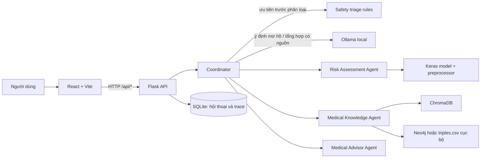

# Tổng quan hệ thống Diabetes AI Multi-Agent

Tài liệu này là phần mô tả kỹ thuật chuẩn để người phát triển, AI Agent hoặc người viết báo cáo hiểu hệ thống dựa trên **mã hiện tại**. Khi thông tin trong tài liệu kế hoạch cũ khác với code, ưu tiên code và ghi rõ khác biệt thay vì mô tả tính năng chưa được triển khai.

## 1. Mục đích và phạm vi

Ứng dụng web demo cho phép người dùng:

1. Hỏi thông tin về bệnh tiểu đường.
2. Nhận nội dung có trích đoạn từ kho tài liệu y tế.
3. Gửi bộ dữ liệu sức khỏe để mô hình Keras đưa ra ước tính nguy cơ.
4. Quan sát ý định được nhận diện, Agent được gọi, nguồn, cảnh báo và lịch sử phiên.

Đây là hệ thống tham khảo phục vụ demo học tập, **không chẩn đoán, không tư vấn điều trị và không thay thế bác sĩ**. Chỉ dùng dữ liệu giả lập; không đưa thông tin cá nhân/sức khỏe thật vào ứng dụng.

## 2. Kiến trúc triển khai



### Công nghệ

- **Frontend:** React 19, Vite 8, JavaScript.
- **Backend:** Python 3.13, Flask và Flask-CORS.
- **Điều phối/Agent:** Python; task/result có schema chung tại `backend/schemas/agent_messages.py`.
- **LLM:** Ollama chạy trên cùng máy (localhost); không cấu hình endpoint LLM cloud.
- **Mô hình nguy cơ:** Keras/TensorFlow với preprocessor đã huấn luyện.
- **Truy xuất tài liệu:** ChromaDB persistent, embedding `paraphrase-multilingual-MiniLM-L12-v2`.
- **Tri thức đồ thị:** Neo4j tùy chọn; khi Neo4j chưa sẵn sàng, truy vấn triệu chứng dùng `data/knowledge/graph/triples.csv` và đánh dấu nguồn là `graph_csv`.
- **Persistence ứng dụng:** SQLite; lưu lịch sử hội thoại và trace thực thi.

## 3. Vai trò các thành phần

| Thành phần | Trách nhiệm hiện tại |
|---|---|
| React UI | Gửi câu hỏi, thu thập 8 trường sức khỏe, hiển thị câu trả lời/trace/nguồn/cảnh báo và tải lịch sử. |
| Flask API | Kiểm tra JSON, kích thước và định dạng yêu cầu; gọi Coordinator; lưu response; cung cấp health/history/trace. |
| Safety triage | Chạy luật cục bộ trước phân loại intent/Agent; nhận diện một số nội dung tự hại, triệu chứng khẩn cấp/hạ đường huyết và câu hỏi liều insulin/thuốc. |
| Coordinator | Chạy safety triage, nhận diện intent, kiểm tra đầu vào tối thiểu, chọn Agent, xác thực kết quả, tổng hợp nội dung và tạo trace. |
| `risk_assessment_agent` | Kiểm tra dữ liệu theo metadata, gọi model Keras và trả nhãn/xác suất cùng metadata và giới hạn. Không tự chẩn đoán. |
| `medical_knowledge_agent` | Truy vấn các đoạn gần nhất trong ChromaDB; tra triệu chứng qua Neo4j khi sẵn sàng hoặc fallback sang `triples.csv`; trả nguồn đúng loại và cảnh báo. |
| `medical_advisor_agent` | Rà soát draft bằng bộ quy tắc cục bộ, chặn một số mẫu khẳng định chẩn đoán/chỉ dẫn thuốc; không phải bộ xác minh tính chính xác y khoa. |
| Ollama | Phân loại câu hỏi chưa rõ bằng prompt JSON allowlist; diễn đạt lại nội dung chỉ khi có nguồn truy xuất. |
| SQLite | Lưu message, câu trả lời, intent, status, response và agent events; không lưu object `health_data` riêng. |

## 4. Luồng xử lý

### 4.1. Gửi chat

1. UI gửi `POST /api/chat` gồm `message`, `session_id` tùy chọn và `health_data` tùy chọn.
2. Flask xác nhận Content-Type, JSON object, message không rỗng (tối đa 4.000 ký tự), `health_data` là object hoặc `null`, và session ID hợp lệ.
3. Coordinator chạy `backend/validators/safety_triage.py` trước các bước sau. Khi luật khớp, trả cảnh báo với `intent: safety`, `status: safety_alert` và trace; không gọi Ollama hoặc Agent. Các trường hợp hiện được bao phủ gồm cụm từ tự hại, một số dấu hiệu khẩn cấp liên quan tiểu đường/hạ đường huyết và câu hỏi có từ khóa về liều insulin/thuốc.
4. Nếu không có cảnh báo an toàn, Coordinator phân loại:
   - Một số từ khóa tiếng Việt/Anh về nguy cơ và triệu chứng được xử lý bằng luật.
   - Một số câu hỏi rõ chủ đề tiểu đường được xếp `knowledge` bằng luật.
   - Câu chưa rõ được chuyển tới Ollama local; kết quả phải thuộc allowlist `knowledge`, `symptoms`, `risk`, `out_of_scope`.
   - Nếu Ollama không khả dụng với câu chưa rõ, Coordinator ghi warning và trả trạng thái không phân loại được thay vì đoán.
5. Coordinator chọn nhánh:
   - `knowledge`: gọi Medical Knowledge Agent.
   - `symptoms`: lấy các triệu chứng có cấu trúc từ Neo4j hoặc CSV cục bộ, tạo câu trả lời trực tiếp từ tên triệu chứng có nguồn (không nhờ LLM dịch/diễn giải lại danh sách) và gọi Medical Advisor Agent rà soát nội dung.
   - `risk`: cần đủ các trường theo model metadata; thiếu trường thì trả `needs_input`, không gọi model. Khi đủ thì gọi Risk Assessment Agent, sau đó truy xuất kiến thức và rà soát câu trả lời.
   - `out_of_scope`: trả lời yêu cầu người dùng hỏi rõ hơn về chủ đề tiểu đường.
6. Với các câu hỏi kiến thức khác, nếu có nguồn Coordinator có thể yêu cầu Ollama tổng hợp dựa trên trích đoạn; khi Ollama lỗi, hệ thống giữ trích đoạn gốc và ghi cảnh báo.
7. API lưu kết quả và trace vào SQLite, rồi trả JSON cho giao diện. Lỗi lưu lịch sử được báo trong warning, không thay thế kết quả Agent hợp lệ.

### 4.2. Luồng dữ liệu sức khỏe

Các input field được lấy từ `models/model_metadata.json`:

| Trường | Kiểu/định dạng | Đơn vị / phạm vi metadata |
|---|---|---|
| `gender` | Danh mục | `Female`, `Male`, `Other` |
| `smoking_history` | Danh mục | `No Info`, `current`, `ever`, `former`, `never`, `not current` |
| `age` | Số | năm, 18–80 |
| `hypertension` | Nhị phân | 0 hoặc 1 |
| `heart_disease` | Nhị phân | 0 hoặc 1 |
| `bmi` | Số | kg/m², 10.01–91.82 |
| `HbA1c_level` | Số | %, 3.5–9.0 |
| `blood_glucose_level` | Số | mg/dL, 80–300 |

Đây là các miền giá trị được mã hóa trong metadata/validator, không phải hướng dẫn tự đo hay ngưỡng chẩn đoán lâm sàng. Khi thành công, model trả `prediction`, `probability`, `threshold`, `model_metrics`, `trained_on` và `limitations`.

## 5. API

### `POST /api/chat`

Request:

```json
{
  "session_id": "demo-session",
  "message": "Tôi muốn đánh giá nguy cơ tiểu đường",
  "health_data": null
}
```

`health_data` phải là `null` hoặc object có đủ 8 trường khi intent là đánh giá nguy cơ. Response thành công thường có `session_id`, `intent`, `answer`, `status`, `agent_trace`, `sources`, `warnings`; nhánh cần bổ sung dữ liệu có thêm `missing_fields`.

### Các endpoint khác

| Method | Endpoint | Mô tả |
|---|---|---|
| `GET` | `/api/health` | Kiểm tra Flask, Ollama, file model, Chroma, Neo4j và SQLite theo chế độ nhẹ. |
| `GET` | `/api/health?deep=1` | Thử load model và truy vấn ChromaDB/kết nối Neo4j; có thể mất thời gian. |
| `GET` | `/api/history?session_id=<id>&limit=20` | Đọc tối đa 100 kết quả trong phiên. |
| `GET` | `/api/agents/status?session_id=<id>` | Trả trace thực thi mới nhất đã lưu và danh sách vai trò được khai báo. |

## 6. Dữ liệu và persistence

- **Tài liệu truy xuất:** file Markdown trong `data/knowledge/text/`; danh mục và ghi chú nguồn ở `data/knowledge/sources.md`. Script `backend/scripts/ingest_knowledge.py` lọc tài liệu được phép rồi thay thế collection ChromaDB.
- **Neo4j và đồ thị cục bộ:** script nạp Neo4j nằm ở `backend/scripts/load_neo4j.py`. Khi Neo4j được cấu hình và truy vấn trả quan hệ phù hợp, nguồn có `origin: neo4j`; nếu chưa cấu hình, không kết nối được, hoặc không có quan hệ phù hợp, Agent tra `data/knowledge/graph/triples.csv` và đánh dấu `origin: graph_csv`. Các bản ghi có tên triệu chứng, source ID, tiêu đề nguồn, mục và bằng chứng.
- **Safety triage:** là luật từ khóa/regex trong `backend/validators/safety_triage.py`, chạy trước intent và truy xuất. Nhánh này không dùng LLM, trả trực tiếp cảnh báo theo mức như `crisis`, `emergency`, `emergency_low_glucose`, `low_glucose_info` hoặc `medication_dose`. Đây là bộ lọc hữu hạn, không phải đánh giá y khoa toàn diện; câu hỏi không khớp luật vẫn đi theo luồng thông thường.
- **Mô hình:** `models/diabetes_mlp.keras` và `models/model_metadata.json`; dịch vụ model còn cần `models/preprocessor.pkl`.
- **Dataset:** `data/raw/dataset.csv`; metadata hiện ghi trường nguồn dataset cần xác nhận. Không suy diễn nguồn dataset trong báo cáo.
- **SQLite:** mặc định `data/chat_history.sqlite3`. Bảng chính `chat_executions` lưu message/answer/response; `agent_events` lưu các event của trace. Code không lưu object `health_data` như một trường lịch sử riêng.
- **Vector store:** mặc định `chroma_db/`; embedding và tài liệu có thể cần khởi tạo/tải lần đầu.

## 7. Cấu hình

Backend nạp `.env` ở thư mục gốc trong `backend/config.py`; biến môi trường được export từ shell được giữ ưu tiên. Các biến chính:

| Biến | Mặc định | Chức năng |
|---|---|---|
| `OLLAMA_BASE_URL` | `http://127.0.0.1:11434` | Địa chỉ Ollama; client chỉ chấp nhận localhost/127.0.0.1. |
| `OLLAMA_MODEL` | `llama3.2:3b` | Tên model Ollama đã tải. |
| `OLLAMA_TIMEOUT` | `90` | Timeout gọi Ollama, đơn vị giây. |
| `FRONTEND_ORIGINS` | localhost:5173 và 127.0.0.1:5173 | Origin được phép qua CORS. |
| `CHROMA_PATH` | `<repo>/chroma_db` | Thư mục persistent ChromaDB. |
| `SQLITE_PATH` | `<repo>/data/chat_history.sqlite3` | File SQLite. |
| `NEO4J_URI` | rỗng | Bật tích hợp đồ thị khi được cấu hình. |
| `NEO4J_USER` | `neo4j` | Tài khoản Neo4j. |
| `NEO4J_PASSWORD` | rỗng | Mật khẩu Neo4j, chỉ lấy từ môi trường. |

Frontend lấy API URL từ `VITE_API_BASE_URL` (mặc định `http://127.0.0.1:5000`) qua `frontend/.env.local`.

## 8. Chạy và kiểm thử

1. Cài Python 3.13, tạo virtualenv và cài dependencies:

   ```bash
   python -m venv .venv
   # Kích hoạt .venv, rồi:
   python -m pip install -r requirements.txt
   ```

2. Tạo `.env` từ `.env.example`, cấu hình Ollama và khởi chạy backend:

   ```bash
   cd backend
   python app.py
   ```

3. Cài và chạy frontend trong terminal khác:

   ```bash
   cd frontend
   npm ci
   npm run dev
   ```

4. Nếu ChromaDB chưa có tài liệu, từ thư mục gốc chạy:

   ```bash
   python backend/scripts/ingest_knowledge.py
   ```

5. Kiểm thử:

   ```bash
   cd backend
   python -m pytest tests -q
   python scripts/eval_knowledge.py
   ```

   `eval_knowledge.py` yêu cầu Flask API đang chạy trên `http://127.0.0.1:5000`; có thể đổi URL bằng `DIABETES_API_BASE_URL`. Bộ đánh giá hiện có 14 tình huống kiến thức, an toàn, nguồn đồ thị và dữ liệu nguy cơ. `python test_step6_integration.py` là smoke test tích hợp, yêu cầu backend và các dependency runtime sẵn sàng. Để lint/build giao diện, chạy riêng `cd frontend && npm run lint && npm run build`.

## 9. Giới hạn và điểm cần xác minh

- `ModelService` cần model, metadata và `preprocessor.pkl`. Kiểm tra `GET /api/health?deep=1` để xác nhận khả năng load trong môi trường hiện tại; không suy luận trạng thái artifact/runtime chỉ từ tên file hoặc health check nhẹ.
- Chế độ Advisor hiện là rule-based MVP (`review_method: rule_based_mvp`), không phải LLM hoặc bộ kiểm chứng y khoa. Bộ quy tắc nhận diện một số mẫu nguy hiểm nhưng không chứng minh nội dung còn lại chính xác.
- Safety triage cũng là lớp luật có phạm vi hữu hạn. Quy tắc liều insulin/thuốc chặn một số câu hỏi có từ khóa về thuốc và liều; không thay thế đánh giá y tế và không đảm bảo nhận diện mọi tình huống nguy hiểm.
- Coordinator hiện dùng luật từ khóa và Ollama để phân loại; không nên mô tả là LLM tự lập kế hoạch phức tạp hay tự chủ hoàn toàn.
- Neo4j không bắt buộc. Dữ liệu triệu chứng trong CSV hỗ trợ fallback khi Neo4j không sẵn sàng; các câu hỏi kiến thức còn lại vẫn phụ thuộc vào ChromaDB.
- ChromaDB có thể rỗng/chưa sẵn sàng; khi đó hệ thống không thể cung cấp câu trả lời dựa nguồn.
- Ollama phải chạy local. Không được mô tả hệ thống gọi dịch vụ LLM bên ngoài.
- Metadata model ghi dataset `source` là “CẦN GHI NGUỒN CHÍNH XÁC”; nguồn và tính đại diện của dữ liệu cần được xác minh trước khi đưa ra kết luận.
- Các chỉ số trong metadata (ROC-AUC, precision, recall, F1) là giá trị ghi nhận sẵn trong artifact, không phải kết quả được tái chạy độc lập trong phiên ứng dụng.

## 10. Hướng dẫn cho AI Agent/người viết báo cáo

Khi dùng tài liệu này để tạo báo cáo:

1. Phân biệt **thiết kế dự kiến**, **triển khai thực tế** và **đề xuất tương lai**.
2. Phân biệt nguồn `neo4j` với `graph_csv`; fallback CSV không chứng minh Neo4j đang hoạt động. Không tuyên bố model prediction, Ollama hoặc ChromaDB hoạt động nếu health check/runtime chưa xác nhận.
3. Nêu rõ giới hạn y tế, nguồn/tính đại diện của dataset, trạng thái artifact/runtime đã kiểm tra và các giả định đơn vị; không biến xác suất/nhãn model thành chẩn đoán.
4. Chỉ trình bày dữ liệu/metrics như nội dung trong metadata, trích dẫn nguồn chính xác và ghi nhận chúng chưa được tái đánh giá nếu chưa chạy kiểm thử.
5. Khi cần bằng chứng triển khai, kiểm tra source dưới `backend/`, `frontend/src/`, `models/model_metadata.json` và tests dưới `backend/tests/`; cập nhật kết luận nếu code đã thay đổi.
6. Không đưa dữ liệu cá nhân hoặc ví dụ định danh vào báo cáo.

Tài liệu kế hoạch nền tảng có tại [Diabetes_AI_Agents_Plan.md](./Diabetes_AI_Agents_Plan.md); đây là tài liệu định hướng, không thay thế xác minh trạng thái triển khai.
